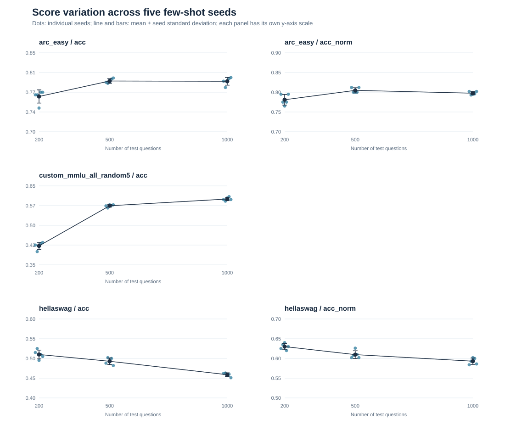

# Day 17｜多任务 few-shot seed 波动

- 模型：`Qwen/Qwen2.5-1.5B`，revision `8faed761d45a263340a0528343f099c05c9a4323`，dtype `bfloat16`。
- 任务：arc_easy, custom_mmlu_all_random5, hellaswag；每个题量使用该任务的前 n 道评测题，5-shot；Python/NumPy/PyTorch seed 固定为 `0/1234/1234`，只改变 few-shot seed。
- `lm-eval` 版本：`0.4.13`；原始结果：`runs\variance`。
- 同一题量内五次使用相同测试题。不同题量的题目集合不同，均值变化不能只归因于题量。
- `custom_mmlu_all_random5` 是自定义实验：从 `cais/mmlu` 的 `all/validation` 随机选 5 个示例，评估 `all/test`；它与内置 MMLU 的固定 `dev` 示例口径不同，分数不能直接对拍。

## 汇总

| 任务 | 指标 | 题量 | seed 数 | 平均分 | seed 间标准差 | 最低～最高 | 极差 | 单次 stderr 均值 |
| --- | --- | ---: | ---: | ---: | ---: | ---: | ---: | ---: |
| `arc_easy` | `acc` | 200 | 5 | 0.7670 | 0.0125 | 0.7450～0.7750 | 0.0300 | 0.0300 |
| `arc_easy` | `acc` | 500 | 5 | 0.7964 | 0.0043 | 0.7920～0.8020 | 0.0100 | 0.0180 |
| `arc_easy` | `acc` | 1000 | 5 | 0.7958 | 0.0074 | 0.7840～0.8030 | 0.0190 | 0.0128 |
| `arc_easy` | `acc_norm` | 200 | 5 | 0.7810 | 0.0134 | 0.7650～0.7950 | 0.0300 | 0.0293 |
| `arc_easy` | `acc_norm` | 500 | 5 | 0.8048 | 0.0066 | 0.8000～0.8120 | 0.0120 | 0.0177 |
| `arc_easy` | `acc_norm` | 1000 | 5 | 0.7976 | 0.0042 | 0.7930～0.8020 | 0.0090 | 0.0127 |
| `custom_mmlu_all_random5` | `acc` | 200 | 5 | 0.4220 | 0.0135 | 0.4000～0.4350 | 0.0350 | 0.0350 |
| `custom_mmlu_all_random5` | `acc` | 500 | 5 | 0.5744 | 0.0050 | 0.5660～0.5780 | 0.0120 | 0.0221 |
| `custom_mmlu_all_random5` | `acc` | 1000 | 5 | 0.6002 | 0.0065 | 0.5920～0.6090 | 0.0170 | 0.0155 |
| `hellaswag` | `acc` | 200 | 5 | 0.5100 | 0.0112 | 0.4950～0.5250 | 0.0300 | 0.0354 |
| `hellaswag` | `acc` | 500 | 5 | 0.4928 | 0.0083 | 0.4820～0.5020 | 0.0200 | 0.0224 |
| `hellaswag` | `acc` | 1000 | 5 | 0.4588 | 0.0048 | 0.4510～0.4630 | 0.0120 | 0.0158 |
| `hellaswag` | `acc_norm` | 200 | 5 | 0.6300 | 0.0079 | 0.6200～0.6400 | 0.0200 | 0.0342 |
| `hellaswag` | `acc_norm` | 500 | 5 | 0.6096 | 0.0098 | 0.6020～0.6260 | 0.0240 | 0.0218 |
| `hellaswag` | `acc_norm` | 1000 | 5 | 0.5930 | 0.0081 | 0.5840～0.6020 | 0.0180 | 0.0155 |

各面板为突出 seed 波动分别调整纵轴范围；跨任务比较请看上表的数值。

## 观察

- `arc_easy` / `acc` 的 seed 间标准差：n=200: 1.25 个百分点；n=500: 0.43 个百分点；n=1000: 0.74 个百分点；这几组观测值并未依次下降。
- `arc_easy` / `acc_norm` 的 seed 间标准差：n=200: 1.34 个百分点；n=500: 0.66 个百分点；n=1000: 0.42 个百分点；这几组观测值依次下降。
- `custom_mmlu_all_random5` / `acc` 的 seed 间标准差：n=200: 1.35 个百分点；n=500: 0.50 个百分点；n=1000: 0.65 个百分点；这几组观测值并未依次下降。
- `hellaswag` / `acc` 的 seed 间标准差：n=200: 1.12 个百分点；n=500: 0.83 个百分点；n=1000: 0.48 个百分点；这几组观测值依次下降。
- `hellaswag` / `acc_norm` 的 seed 间标准差：n=200: 0.79 个百分点；n=500: 0.98 个百分点；n=1000: 0.81 个百分点；这几组观测值并未依次下降。

## MMLU 测试题学科构成

- n=200：abstract_algebra 100、anatomy 100。
- n=500：abstract_algebra 100、anatomy 135、astronomy 152、business_ethics 100、clinical_knowledge 13。
- n=1000：abstract_algebra 100、anatomy 135、astronomy 152、business_ethics 100、clinical_knowledge 265、college_biology 144、college_chemistry 100、college_computer_science 4。

MMLU 的 `all/test` 前缀按学科聚集；扩大 `--limit` 会加入新学科。三档平均分变化同时反映题目构成变化，不能解释成题量本身提高了模型能力。

## 每个 seed 的原始分数

- `arc_easy` / `acc` / n=200：1: 0.7700、2: 0.7700、3: 0.7450、4: 0.7750、5: 0.7750。
- `arc_easy` / `acc` / n=500：1: 0.7940、2: 0.7920、3: 0.7940、4: 0.8000、5: 0.8020。
- `arc_easy` / `acc` / n=1000：1: 0.7960、2: 0.7840、3: 0.7950、4: 0.8010、5: 0.8030。
- `arc_easy` / `acc_norm` / n=200：1: 0.7950、2: 0.7750、3: 0.7650、4: 0.7750、5: 0.7950。
- `arc_easy` / `acc_norm` / n=500：1: 0.8120、2: 0.8000、3: 0.8000、4: 0.8000、5: 0.8120。
- `arc_easy` / `acc_norm` / n=1000：1: 0.8020、2: 0.7930、3: 0.7950、4: 0.7960、5: 0.8020。
- `custom_mmlu_all_random5` / `acc` / n=200：1: 0.4250、2: 0.4000、3: 0.4200、4: 0.4300、5: 0.4350。
- `custom_mmlu_all_random5` / `acc` / n=500：1: 0.5740、2: 0.5660、3: 0.5780、4: 0.5760、5: 0.5780。
- `custom_mmlu_all_random5` / `acc` / n=1000：1: 0.5980、2: 0.5920、3: 0.6040、4: 0.6090、5: 0.5980。
- `hellaswag` / `acc` / n=200：1: 0.5150、2: 0.5250、3: 0.4950、4: 0.5100、5: 0.5050。
- `hellaswag` / `acc` / n=500：1: 0.4880、2: 0.5020、3: 0.4920、4: 0.5000、5: 0.4820。
- `hellaswag` / `acc` / n=1000：1: 0.4620、2: 0.4630、3: 0.4580、4: 0.4600、5: 0.4510。
- `hellaswag` / `acc_norm` / n=200：1: 0.6250、2: 0.6350、3: 0.6400、4: 0.6200、5: 0.6300。
- `hellaswag` / `acc_norm` / n=500：1: 0.6020、2: 0.6080、3: 0.6260、4: 0.6100、5: 0.6020。
- `hellaswag` / `acc_norm` / n=1000：1: 0.5840、2: 0.5930、3: 0.6020、4: 0.6000、5: 0.5860。

## 如何解释

- `seed 间标准差`描述固定题目和推理配置时，更换 5-shot 示例带来的五次分数波动；只有 5 个 seed，估计仍较粗。
- `单次 stderr`由每次运行的逐题 0/1 正误估计，描述题目层面的标准误。两者对应不同的变化来源，不能直接相除来证明“额外方差”。
- 200、500、1000 题采用测试集前缀，不能据此推断随机抽题时分数会如何波动。若要估计抽题不确定性，需要单独做随机抽样或逐题 bootstrap。
- 某个题量下观察到的最高与最低分数差，也不能直接当作两个模型分数差异显著性的门槛；比较模型需要相同题目和逐题配对分析。
- 本实验使用 `--limit`，结果只代表各任务选定的前 n 道题，不是完整 benchmark 分数。

重复结果文件：1 份；相同 seed 的配置和分数一致，汇总时只计一次。
