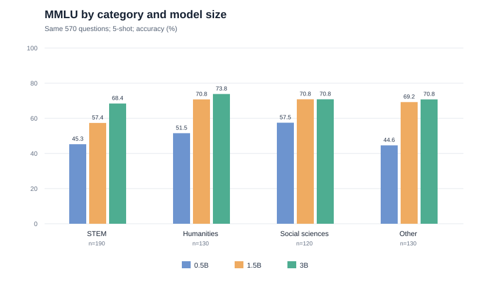
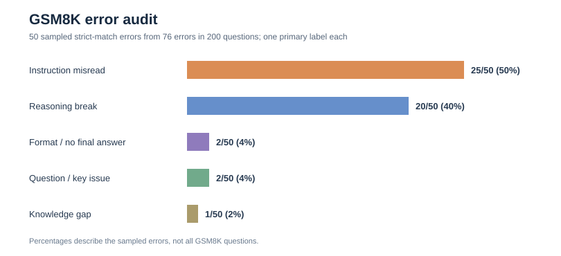

# Day 20｜能力分维度分析与错题复核

## 评测口径

- 模型：Qwen2.5 base 0.5B、1.5B、3B；精确版本见 [`results/day06_models.json`](../results/day06_models.json)。
- MMLU：三个模型使用同一批 570 道题（57 个学科各取前 10 道），5-shot；按 lm-eval 学科映射汇总。这里的百分数只描述这批抽样题，不是完整 MMLU 成绩。运行记录来自 Day 6；分组数据见 [`day20_mmlu_by_category.csv`](day20_mmlu_by_category.csv)。
- GSM8K 错题：Qwen2.5-1.5B、test 前 200 道、5-shot、`strict-match`。答对 124 道，答错 76 道；使用固定种子 `20261010` 从 76 道错题中随机取 50 道，逐条阅读题目、完整模型回答和参考解答，给一个主要错误类别。公开的标签与简要证据见 [`day20_manual_labels.json`](day20_manual_labels.json)；包含完整题目和回答的 `day20_gsm8k_error_sample.csv` 留在本地，不入库。

## 一、MMLU：分组成绩



| 类别 | 题数 | 0.5B | 1.5B | 3B | 3B－0.5B | 3B－1.5B |
| --- | ---: | ---: | ---: | ---: | ---: | ---: |
| STEM | 190 | 45.26% | 57.37% | 68.42% | +23.16 百分点 | +11.05 百分点 |
| 人文 | 130 | 51.54% | 70.77% | 73.85% | +22.31 百分点 | +3.08 百分点 |
| 社会科学 | 120 | 57.50% | 70.83% | 70.83% | +13.33 百分点 | +0.00 百分点 |
| 其他 | 130 | 44.62% | 69.23% | 70.77% | +26.15 百分点 | +1.54 百分点 |

从 1.5B 到 3B，STEM 在这批题上的净增幅最大：多答对 21/190 道，增加 11.05 个百分点。社会科学的总分相同，但逐题比较仍有 8 道由错变对、8 道由对变错；相同总分不等于逐题结果一致。人文和其他分组增幅较小，也不能仅凭这批题断言更大模型在这些领域已达到上限。每学科只取 10 道题，学科级波动很大。

这三款是不同参数规模的模型，**不是同一个模型训练过程中的连续 checkpoint**。因此这里比较的是规模与分组表现，不能把少数逐题退步解释为“训练退化”。数据也没有可信的逐题难度标签，本报告不做难度分层。

## 二、50 道 GSM8K 错题的人工分类



分类规则：只根据可见题目和回答判断主要失误位置；一题可能兼有多种问题，但这里只记一个主类。“知识缺失”也只是对输出表现的归类，无法证明模型内部不知道相应知识。

| 主要类别 | 判定线索 | 数量 | 在这 50 道错题中的占比 |
| --- | --- | ---: | ---: |
| 知识缺失 | 不会应用必要的基础概念或公式 | 1 | 2% |
| 推理断裂 | 已读到条件，但中间计算、变量关系或结论不成立 | 20 | 40% |
| 格式错误 | 结果未按 `#### 数字` 规则结束，严格抽取失败 | 2 | 4% |
| 指令误解 | 漏读、错读题干条件，或把条件改成另一种含义 | 25 | 50% |
| 题目本身有问题 | 题干歧义或参考解答存在可核对的问题 | 2 | 4% |

典型例子：

- **题号 2，推理断裂**：买房 8 万、维修 5 万、房价增加 12 万。模型把维修费再次加进房屋现值，还没有从最终收入扣掉维修成本，得 17 万；参考利润为 `20 万－13 万＝7 万`。
- **题号 5，指令误解**：“每第二个杯子按原价的 60%”被读成之后每一个杯子的价格都是前一个的 60%，因此把 16 个杯子的总价算成 10，而正确答案是 64。
- **题号 184，知识缺失**：两次独立掷骰子的联合概率应为 `(3/6)²`，回答却用了 `3/6 × 2/6`。
- **题号 85、186，格式错误**：回答重复直到截断，没有形成符合严格抽取规则的最终 `####` 答案。题号 85 的回答中已出现正确数字 44；题号 186 的推理也未正常结束，所以不能把这两道都称为“只差格式、数学已做对”。
- **题号 119、146，题目或标签需复核**：119 的参考解答把“Adrien 比 Lylah 高 30%”错误地反推为“Lylah 比 Adrien 低 30%”；146 中“另一个数量为其 1/4”所指对象不清。两题的模型结果仍不能直接改判正确，应先确定题意与金标准。

**这些比例的分母是抽出的 50 道已判错题**，不是全部 200 道 GSM8K 题，更不是模型在整个数据集的错误类型比例。人工主类带主观性，尤其“指令误解”和“推理断裂”有交界；逐题证据比单个类别名称更重要。

## 三、发现分数变化时怎么定位

1. 先固定模型 revision、数据集切分与题目顺序、任务 YAML、few-shot 示例与种子、提示词、生成配置、抽取规则；确认两次分数可比。
2. 再看分组成绩和逐题翻转：哪组变化、多少题错变对、多少题对变错。总分相同也要查翻转。
3. 抽取错题读完整回答，分清题意理解、计算链、最终格式和题目金标准问题；`[invalid]` 不自动等于模型完全不会做。
4. 最后才讨论原因。若要分析真正的 checkpoint 退化，需要同一训练谱系的多个 checkpoint 在同一口径下重跑；本报告的数据只支持不同模型规模的横向描述。

## 复现入口与边界

```powershell
Set-Location '<你的仓库目录>\llm-eval-diagnostics'
conda activate lmeval
python .\src\day20_capability_chart.py
python .\src\day20_sample_errors.py
python .\src\day20_apply_labels.py
```

前两步从已有运行日志生成图表和固定样本；最后一步把已人工核过的 [`day20_manual_labels.json`](day20_manual_labels.json) 合入复核表，不会重新调用模型。`--limit` 是抽样实验设置，不能把这些数字当作完整基准榜单。后续若复核了有歧义的题，须同时更新标签依据和此报告。
